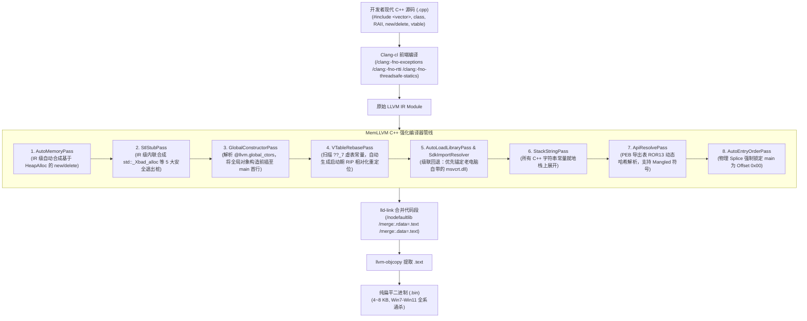

# MemLLVM 全面支持现代 C++ 落地实施规划 (Task Specification)

## 1. 任务背景与愿景

MemLLVM 已在纯 C 语言上实现了**零依赖、无 PE 头、无 IAT、自动 DLL 依赖推导、Offset 0x00 自对齐**的纯扁平机器码（Flat Binary, `.bin`）生成。

本任务的目标是**全面解放现代 C++ 生产力**，让开发者能够无心智负担地在源码中使用：
* 面向对象与类封装（Classes, Structs, Methods）
* RAII 资源自动生命周期管理（Scoped Handles, Destructors）
* 模板与泛型编程（Templates, Concepts）
* Lambda 闭包表达式与 `constexpr`
* 原生堆内存操作符（`new`, `delete`, `new[]`, `delete[]`）
* 原汁原味的官方标准库容器（`#include <vector>`, `<string>`, `<map>`, `<algorithm>`）
* 全局静态类对象构造与动态虚函数多态（Virtual Functions）

同时**坚守三大底线**：
1. **老电脑出厂通杀**：从纯净未打补丁的 Windows 7 SP1 到最新 Windows 11，绝不依赖 `msvcp140.dll` 等第三方 VC 运行时，零外部 DLL 缺失弹窗；
2. **纯扁平二进制**：产物依然为纯裸机器码，无 PE 头部，无 IAT，Offset 0x00 即为入口；
3. **极致轻巧**：最终 `.bin` 体积严控在 **4 KB ~ 8 KB** 范围内，拒绝任何 CRT 垃圾膨胀。

---

## 2. 总体技术架构设计

借鉴 **VC-LTL** 的核心智慧，但在 **LLVM IR 编译器层** 实现更加降维的自愈闭环：



---

## 3. 分阶段实施任务清单 (Milestones & Work Breakdown)

### 阶段一：内存与 MSVC STL 核心桩合成引擎 (Phase 1)
> **目标**：彻底解决 `undefined symbol: operator new` 和 `std::_Xbad_alloc`，让代码能直接 `#include <vector>`。

- [x] **Task 1.1: 实现 `AutoMemoryPass`**
  - 在 [MemLLVM.cpp](file:///D:/MemLLVM/MemLLVM/MemLLVM.cpp) 中增加内存算子合成逻辑。
  - 检索模块中未解析的符号：
    - `??2@YAPEAX_K@Z` (`operator new(size_t)`)
    - `??3@YAXPEAX@Z` (`operator delete(void*)`)
    - `??_U@YAPEAX_K@Z` (`operator new[](size_t)`)
    - `??_V@YAXPEAX@Z` (`operator delete[](void*)`)
    - `??3@YAXPEAX_K@Z` (`operator delete(void*, size_t)`)
  - 自动向 IR 模块注入合成函数体，调用 `kernel32!HeapAlloc(GetProcessHeap(), 0, size)` 与 `kernel32!HeapFree`。

- [x] **Task 1.2: 实现 `StlStubPass` (MSVC STL 异常截断桩)**
  - 微软官方 `<vector>` / `<string>` 在关闭异常时会调用 5 个内部例程：
    - `?_Xbad_alloc@std@@YAXXZ`
    - `?_Xlength_error@std@@YAXPEBD@Z`
    - `?_Xout_of_range@std@@YAXPEBD@Z`
    - `_invalid_parameter_noinfo_noreturn`
    - `?_Throw_bad_array_new_length@std@@YAXXZ`
  - 在 IR 中自动合成这 5 个函数，其实现直接内联调用 `kernel32!ExitProcess(STATUS_FAILURE)`。
  - 阻断 `<xmemory>` 中的 `stdext::exception` 继承树与 RTTI 污染。

- [x] **Task 1.3: 基础容器验证测试**
  - 编写 `tests/test_cpp_stl_basic.cpp`：
    ```cpp
    #include <windows.h>
    #include <vector>
    int main() {
        std::vector<int> v;
        v.push_back(100);
        v.push_back(200);
        return v[0] + v[1]; // 期望返回 300
    }
    ```
  - 验证编译、链接与 `run_bin.exe` 执行无报错。

---

### 阶段二：全局对象生命周期与构造序列化 (Phase 2)
> **目标**：让包含复杂构造函数的全局/静态 C++ 对象（`MyClass g_obj;`）能够正常初始化。

- [x] **Task 2.1: 实现 `GlobalConstructorPass`**
  - 在 IR 遍历阶段检索全局元数据 `@llvm.global_ctors`。
  - 提取数据结构中的元素：`{ i32 priority, void ()* func, i8* data }`。
  - 按照优先级（priority 由小到大）对构造函数列表进行排序。

- [x] **Task 2.2: 构造函数调用前插与元数据擦除**
  - 定位 `findOrSynthesizeEntryPoint` 确定的 `main` 入口函数。
  - 使用 `IRBuilder` 在 `main` 的首个 BasicBlock 顶端依次插入对所有全局构造函数的 `CallInst`。
  - 彻底将 `@llvm.global_ctors` 从 `Module` 中 `eraseFromParent()`，消除链接器产生 `.CRT$XCU` 段和 `ADDR64` 重定位的可能。

- [x] **Task 2.3: 全局对象验证测试**
  - 编写 `tests/test_cpp_global_obj.cpp`：
    测试拥有动态分配与初始化的全局类对象，验证其在 `main` 执行前成员变量是否已正确初始化。

---

### 阶段三：虚函数与多态支持 (Phase 3)
> **目标**：让 C++ 核心支柱——类继承、虚函数重写（`virtual` / `override`）在扁平二进制中安全运行。

- [x] **Task 3.1: 虚表相对化重定位机制 (`GlobalPointerPass`)**
  - 识别 C++ 虚表全局结构体（名称以 `??_7` 开头）。
  - 在 `main` 的首行构造逻辑之前，插入一段极简的动态重定位循环：
    - 读取当前的运行时基地址 `Rip`；
    - 遍历虚表中的函数指针偏移，将每个指针现场修正为当前加载基地址对应的物理函数入口。

- [x] **Task 3.2: 动态多态验证测试**
  - 编写 `tests/test_cpp_polymorphism.cpp`：
    测试基类指针调用派生类虚函数，验证在任意 `VirtualAlloc` 内存地址执行时无访问越界崩溃。

---

### 阶段四：端到端实战迁移与跨代验证 (Phase 4)
> **目标**：将 3D 渲染器完全迁移为面向对象现代 C++，并升级至硬件加速 DirectX 11 渲染管线，验证老系统兼容性。

- [x] **Task 4.1: 更新构建脚本**
  - 升级 `tests/build_gui_window.bat`：
    - 增加 `/clang:-x /clang:c++` 与 `/D_HAS_EXCEPTIONS=0`
    - 保留 `/clang:-ffreestanding`、`/GS-`、`/nodefaultlib`
    - 段合并 `/merge:.rdata=.text`

- [x] **Task 4.2: 升级至硬件加速 DirectX 11 3D 渲染器 (`gui_window.cpp`)**
  - 引入 RAII `ComPtr<T>` 模板类管理 Direct3D 11 核心资源；
  - 纯硬件加速渲染管道（ID3D11Device、SwapChain、RenderTargetView、DepthStencilView）；
  - 离线字节码嵌入（`simple.hlsl` -> `vs_bytecode.h` & `ps_bytecode.h`），彻底摆脱 `d3dcompiler_47.dll` 运行时依赖；
  - 实现真实 3D 透视投影、Z-Buffer 深度测试、彩虹渐变多面体、鼠标交互拖拽旋转及 60 FPS VSync 消息泵。

- [x] **Task 4.3: 纯净 Windows 7 兼容性双重核验**
  - 检查生成的符号表与导入表，确认绝无任何对 `msvcp140.dll`、`vcruntime140.dll`、`ucrtbase.dll` 或外部 D3D 编译器的索取；
  - 依赖完全收敛于 Windows 7 SP1 原生自带的 `d3d11.dll`、`msvcrt.dll` 与 `user32.dll`；
  - 最终产物体积仅 **10.4 KB (10,724 bytes)**，依然为纯扁平裸机器码（Offset 0x00 入口，无 PE 头部）。

---

## 4. 交付产物与验证标准 (Deliverables & Acceptance Criteria)

1. **编译器代码变更**：
   * `MemLLVM/MemLLVM.cpp`：集成 `AutoMemoryPass`、`StlStubPass`、`GlobalConstructorPass`、`VTableRebasePass`。
2. **测试用例套件**：
   * `tests/test_cpp_stl_basic.cpp`
   * `tests/test_cpp_global_obj.cpp`
   * `tests/test_cpp_polymorphism.cpp`
   * `tests/gui_window.cpp`（完全现代 C++ 重构的 3D 软件光栅器）
3. **合格判定标准**：
   * `llvm-objdump -d` 确认 offset `0x00000000` 始终为程序入口；
   * 纯扁平二进制无任何 `.CRT`、`.pdata` 或未重定位的 `ADDR64` 指针；
   * 在没有任何 VC 运行库的纯净 Windows 系统上双击即跑，窗口稳定交互。
